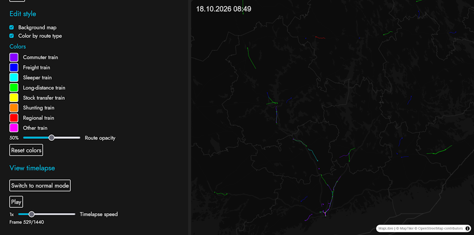

# Transport visualizer
A system to view historical positions of vehicles on a map, as a timelapse, or even exported as an mp4 file.

The project consists of a backend and frontend in the same repo.
The project can be used at [https://tvis.hekinav.dev](https://tvis.hekinav.dev/)

## Table of contents
- **[Frontend](#frontend)**
- **[Backend](#backend)**



# Backend

The backend is a node.js typescript server which takes in data from [Digitraffic MQTT](https://www.digitraffic.fi/rautatieliikenne/#websocket-mqtt) and stores it in a postgres database. The data can be accessed via a public REST API using Express.js.

The server code is all in `src/main.ts`. The main function `start()` is the entry point to the code.

## Usage

1. **Configure .env file**: Follow the instructions in .env.template
2. **Install dependencies**: `npm i`. 
3. **Start dev server**: `npm run dev`. 
4. **Start production server**: `npm run build & npm run pm2:start`. 
5. **Stop production server**: `npm run pm2:stop`. 

## Bulk importing data

`src/data/import.ts` is a script to bulk import all events from one day to the database. The archived GPS positions can be found at [the Digitraffic Archive](https://rata.digitraffic.fi/api/v1/train-locations/dumps/list.html).

To use the script, you need to manually set the date and filename in the import.ts file. (rows 288 and 305)

Execute the script with tsx and wait for the import to complete. It usually takes around 4 minutes (~5 million gps events).


## API Definition

The API always returns JSON. The JSON can include an error or data

### Error format

```json
{
    "code": 500,  // Matches HTTP status code
    "message": "" // Describes the error
}
```

### /api/v2/trips

Returns a list of trips, optionally including location messages.

#### Query parameters

**messages**: If the parameter is defined (no value required), messages are included for each trip

**dataSource**: Filters the data source of trips. Valid values: DIGITRAFFIC

**departureDate**: Filters the departure date of trips. Valid values: RFC3339 date format. Example: `2026-10-15`
**departureDateRange**: Filters the departure date of trips with a range. Valid values: Two RFC3339 dates. Example: `2026-10-15:2027-01-01`

**endPoint**: Filters endPointId attribute of trips. Comma-separated values are treated as an OR statement. Example: `HKI,ROI,KV,TPET`

**startPoint**: Filters startPointId attribute of trips. The same comma function as endPoint applies.

**terminus**: Filters trips by either the start point or the end point, so a value of `HKI` matches trips starting and ending at Helsinki station. The same comma function as endPoint applies.

#### Data format

```json
{
    "data": [
        {
            "dataSource": "DIGITRAFFIC", // "DIGITRAFFIC"
            "departureDate": "2026-10-15",
            "endPointId": "HKI",
            "endPointName": "Helsinki asema",
            "operatorId": "vr",
            "operatorName": "VR-Yhtymä Oyj",
            "route": "IC 62", // passenger facing route descriptor
            "routeType": "TRAIN_LONG_DISTANCE", // "BUS", "TRAIN_LONG_DISTANCE", "TRAIN_COMMUTER", "TRAIN_FREIGHT", "TRAIN_SHUNT", "TRAIN_OTHER", "TRAIN_REGIONAL", "TRAIN_TRANSFER", "TRAIN_SLEEPER", "TRAM", "FERRY", "LIGHT_RAIL"
            "startPointId": "KAJ",
            "startPointName": "Kajaani",
            "tripId": "2026-10-15/62",
            // messages property is only available when requested with the &messages query parameter
            "messages": [
                {
                    "lat": 27.74642,
                    "lng": 64.220061,
                    "messageId": 19420, // running count integer
                    "timestamp": "2026-10-14T22:41:55Z",
                    "tripId": "2026-10-15/62"
                },
                // ...
            ],
        }
        // ...
    ]
}
```
### /api/v2/dates

Returns a list of departure dates with data available

#### Query parameters

**dataSource**: Filters the data source of departure dates. Valid values: DIGITRAFFIC

#### Data format

```json
{
    "data": [
        "2026-10-14",
        "2026-10-15"
        // ...
    ]
}
```

# Frontend

The frontend fetches data from the backend and shows it on an interactive Maplibre map. The frontend is built with Vanilla TS and Vite. The frontend can also export a timelapse as mp4 by using a hidden map to render the frames and ffmpeg wasm to combine frames into a video.

## Usage

All commands should be executed in the `/frontend` directory

**Important!** Make sure to get your own Maptiler API key (free) and update it to `/public/map_style.json`

1. Install dependencies `npm install`
2. Start dev server `npm run dev`
3. Build production version `npm run build`
4. Test production version locally `npm run preview`
5. Deploy to cloudflare workers `npm run deploy`
